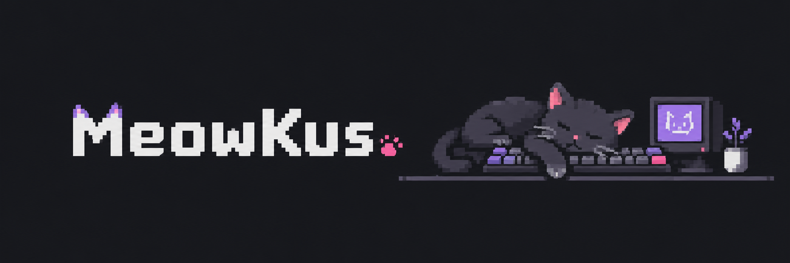

---

## 👋 Обо мне

<table>
<tr>
<td width="60%" valign="top">

Я разработчик из Москвы. Больше всего люблю делать штуки, которыми сам пользуюсь. Если удобного инструмента нет, я просто сажусь и пишу его сам.

- 🌐 Чаще всего пишу на TypeScript
- 🦀 Для программ на десктоп беру Rust и C#
- 🐍 Для ботов и автоматизации беру Python
- 🎮 Иногда делаю моды и плагины для игр
- 🐈 Кот одобряет большинство коммитов

</td>
<td width="40%" align="center" valign="middle">

</td>
</tr>
</table>

## 🛠 Чем пользуюсь

## 🚀 Что можно посмотреть

<table>
<tr>
<td width="50%" valign="top">

### 🎵 [Pylon](https://github.com/MeowKusTrue/Pylon)

Медиаплеер для Windows на движке VLC, только красивый. Тексты песен идут синхронно с музыкой, есть эквалайзер, конвертер и трансляция на телевизор.

[⬇️ Скачать](https://github.com/MeowKusTrue/Pylon/releases/latest) · [Код](https://github.com/MeowKusTrue/Pylon)

</td>
<td width="50%" valign="top">

### 📸 [Snapling](https://github.com/MeowKusTrue/Snapling)

Скриншоты для Windows и Linux: выделение области, стрелки и подписи, распознавание и перевод текста. Есть запись GIF и видео, длинные скриншоты и закрепление поверх окон.

[⬇️ Скачать](https://github.com/MeowKusTrue/Snapling/releases/latest) · [Код](https://github.com/MeowKusTrue/Snapling)

</td>
</tr>
</table>

## 🔒 А что за закрытыми дверями

Основное время уходит на приватные проекты. Показать их пока нельзя, но коротко расскажу, что там:

| Что | На чём |
| --- | --- |
| 🌐 Сайты, сервисы и API | TypeScript, NestJS, Next.js |
| 🖥 Программы для Windows | Rust, C#, WPF |
| 📱 Приложение для Android | Kotlin |
| 🤖 Боты и автоматизация | Python, Node.js |
| 📚 Документация и SDK | MDX, TypeScript |

## 🐍 Мой год в коммитах

## 📦 Последние релизы

| 🎵 Pylon | 📸 Snapling |
| :---: | :---: |
|  |  |
|  |  |
| [⬇️ Скачать для Windows](https://github.com/MeowKusTrue/Pylon/releases/latest/download/Pylon-win-Setup.exe) · [Что нового](https://github.com/MeowKusTrue/Pylon/releases/latest) | [⬇️ Скачать для Windows](https://github.com/MeowKusTrue/Snapling/releases/latest/download/Snapling-Setup.exe) · [Что нового](https://github.com/MeowKusTrue/Snapling/releases/latest) |

## 🚀 Проекты в цифрах

| Проект | Скачивания | Звёзды |
| :--- | :---: | :---: |
| [🎵 Pylon](https://github.com/MeowKusTrue/Pylon) |  |  |
| [📸 Snapling](https://github.com/MeowKusTrue/Snapling) |  |  |

## 📫 Как со мной связаться

Пишите, если есть идея, вопрос или хочется что-то сделать вместе.

